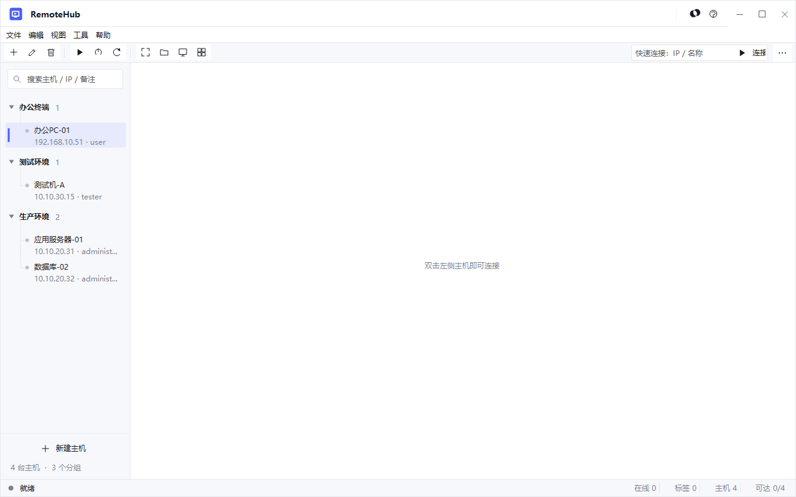
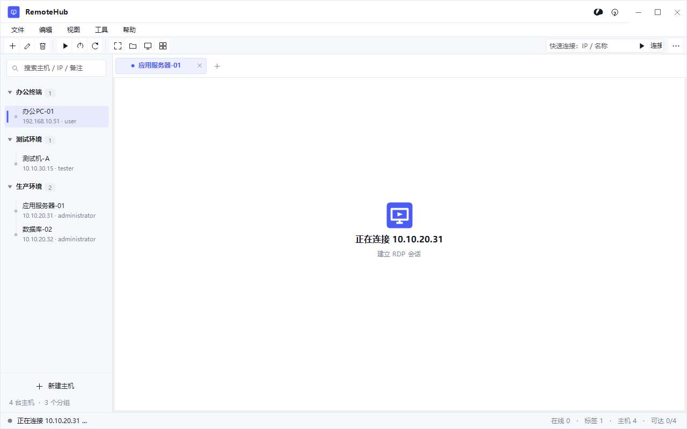
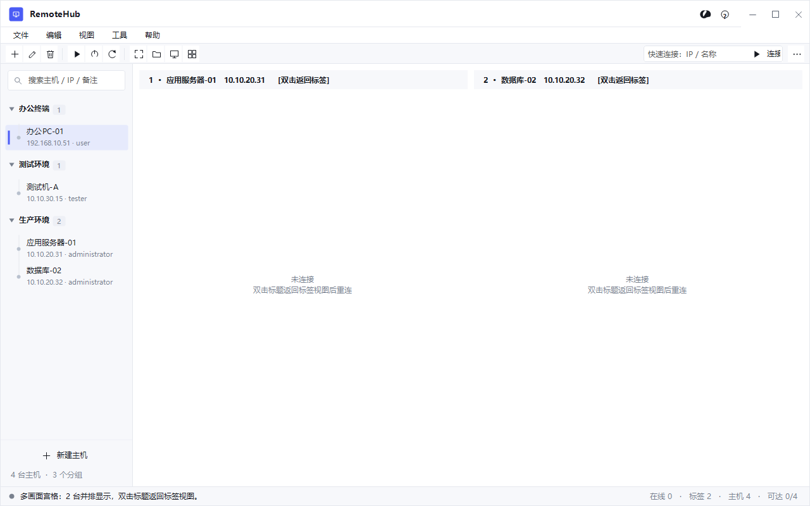
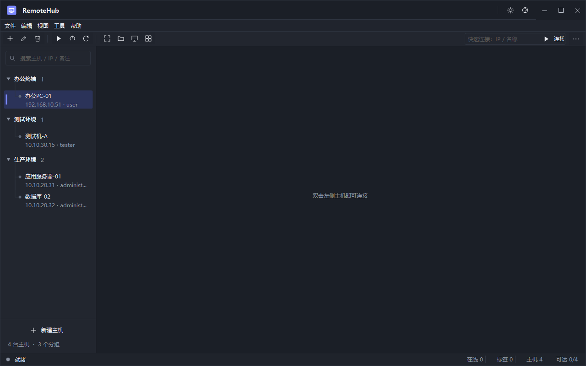
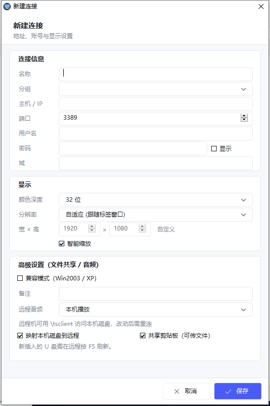
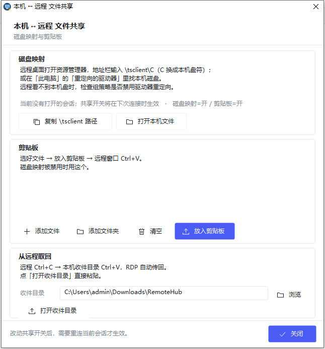
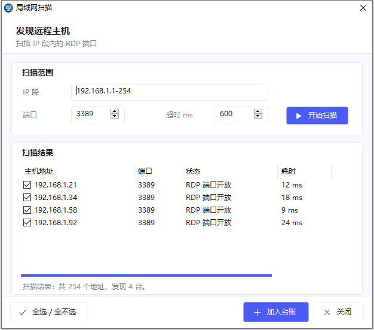
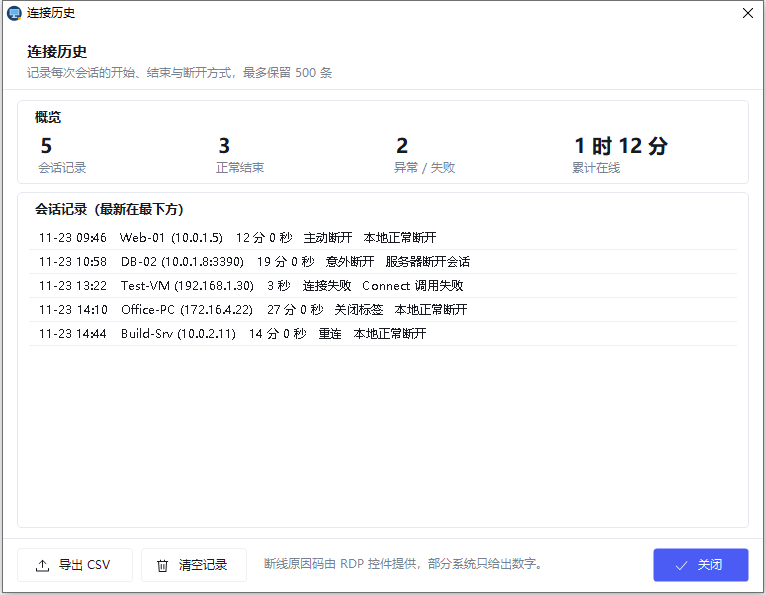

<div align="center">

# RemoteHub

**Windows 平台的多标签内嵌式远程桌面工作台**

把远程画面直接嵌进程序窗口，而不是弹出一个独立的系统远程桌面窗口。


[](https://github.com/pishipeng123/RemoteHub-Windows/releases/latest)

</div>

---

## 直接下载

| 包 | 大小 | 说明 |
| --- | --- | --- |
| [**RemoteHub-1.4.0-Setup.exe**](https://github.com/pishipeng123/RemoteHub-Windows/releases/download/v1.4.0/RemoteHub-1.4.0-Setup.exe) | 2.0 MB | 安装版：开始菜单、桌面快捷方式、可选开机自启、「应用和功能」中可卸载 |
| [**RemoteHub-1.4.0-Portable.zip**](https://github.com/pishipeng123/RemoteHub-Windows/releases/download/v1.4.0/RemoteHub-1.4.0-Portable.zip) | 95 KB | 绿色版：解压即用，不写注册表、不装服务，整个目录可拷到 U 盘 |

需要其他版本见 [Releases 页面](https://github.com/pishipeng123/RemoteHub-Windows/releases)。

## 这是什么

市面上的远程工具大多分两类：调用系统 `mstsc.exe`（弹窗、要来回切窗口），或者自研私有协议客户端（被控端必须装 Agent）。

RemoteHub 走第三条路：**直接用 Windows 自带的 RDP ActiveX 控件（`mstscax.dll`），以进程内方式嵌在自己的窗体里**。

由此带来的直接结果：

- 远程画面就是程序窗口的一部分，**不弹第二个窗口**，切标签即可在多台主机之间切换；
- 被控端**不需要安装任何 Agent**，只要 Windows 系统里开着「远程桌面」就能连；
- 不引入私有协议、不联网、不采集任何数据，安全模型就是 Windows 自己的 RDP。

## 效果

### 主界面

主机台账在左侧，会话在工作区，顶部是菜单栏与工具栏。



### 会话与标签页

每个远程连接占一个标签页，圆点表示在线状态。



### 多画面宫格

把前 2–4 个会话铺成网格，用于同时盯多台机器。



### 深色主题



### 新建连接



### 文件共享助手



### 局域网扫描



### 连接历史



### 台账主密码 / 自动锁定


> 截图使用示例数据生成，与任何真实主机无关。

## 功能

| 类别 | 能力 |
| --- | --- |
| 会话管理 | 多标签并行、标签状态点（在线 / 离线 / 当前）、关闭标签、重连、快速连接栏（输 IP 回车即连） |
| 画面尺寸 | **跟随窗口**自动铺满（在线改分辨率，不掉线）、固定分辨率模式、全屏时分辨率同步、退出全屏自动还原 |
| 文件共享 | 映射本机磁盘到远程（`\\tsclient\C`）、共享剪贴板传文件、从远程取回文件、内置传文件助手 |
| 音频重定向 | 每台主机可选「本机播放 / 远程播放 / 静音」 |
| 安全键 | 一键向远程发送 `Ctrl+Alt+Del`（SAS） |
| 主机管理 | 分组台账、搜索、批量导入 / 导出 CSV、复制连接、在线状态探测 |
| 局域网扫描 | IP 段并发扫描 3389 端口，批量加入台账 |
| 多画面 | 2–4 会话宫格，双击标题返回标签视图 |
| 记录 | 连接历史（时长 / 结果 / 原因码），可导出 CSV |
| 隐私 | 台账主密码、空闲自动锁定、启动锁定遮罩 |
| 界面 | 浅色 / 深色主题、可拖动侧栏宽度、纯图标工具栏、完整菜单栏 |

完整操作说明见 [`UserGuide.txt`](UserGuide.txt)。

## 系统要求

| | 要求 |
| --- | --- |
| 操作系统 | Windows 7 SP1 / Windows 10 / Windows 11（需启用「远程桌面客户端」可选功能） |
| 运行时 | .NET Framework 4.x（Windows 10/11 自带，无需安装） |
| 编译环境 | 无需 Visual Studio、.NET SDK、NuGet |
| 被控端 | Windows + 系统远程桌面服务，**无需安装 RemoteHub 或任何 Agent** |

## 快速开始

### 方式一：直接下载成品

在仓库的 [Releases](https://github.com/pishipeng123/RemoteHub-Windows/releases) 页面下载，或直接用上方的直链。

| 包 | 说明 |
| --- | --- |
| `RemoteHub-1.4.0-Setup.exe` | 安装版：开始菜单、桌面快捷方式、可选开机自启、「应用和功能」中可卸载 |
| `RemoteHub-1.4.0-Portable.zip` | 绿色版：解压即用，不写注册表、不装服务，整个目录可拷到 U 盘 |

### 方式二：从源码编译（不需要 Visual Studio）

仓库自带 `build.bat`，直接调用 Windows 自带的 .NET Framework 编译器：

```bat
git clone https://github.com/pishipeng123/RemoteHub-Windows.git
cd RemoteHub-Windows
build.bat anycpu
```

产物是根目录下的 `RemoteHub.exe`（双击即可运行）。

`build.bat` 参数：

| 参数 | 作用 |
| --- | --- |
| `build.bat` | 构建 AnyCPU（64 位 Windows 上推荐） |
| `build.bat x86` | 构建 32 位（本机缺少 64 位 RDP 控件时使用） |
| `build.bat anycpu silent` | 不暂停等待，用于自动化构建 |

打包安装版与绿色版（**需要预先安装 Inno Setup 6/7**）：

```bat
build-release.bat
```

产物输出到 `dist/`：安装包 `RemoteHub-1.4.0-Setup.exe` 与绿色版 `RemoteHub-1.4.0-Portable.zip`。

### 方式三：用 Visual Studio 打开

仓库附带 `RemoteHub.csproj`（.NET Framework 4.8），可直接用 Visual Studio 2019/2022 打开。
若本机没有 .NET Framework 4.8 目标包，Visual Studio 会提示安装。

> 官方验证过的构建路径是 `build.bat`——它不依赖任何第三方工具。`.csproj` 是为了方便 IDE 浏览和调试而提供的等价工程文件。

## 使用

1. 双击 `RemoteHub.exe`；
2. 点工具栏「新建连接」填写主机，或用「批量导入」粘贴 CSV 建立台账；
3. 双击左侧主机即可连接，每个连接占一个标签页；
4. 菜单「帮助 → 环境自检」可查看本机 RDP 控件版本、密码注入、动态分辨率、文件重定向、音频重定向与安全键是否可用。

### 常用快捷键

| 快捷键 | 作用 | 快捷键 | 作用 |
| --- | --- | --- | --- |
| `Ctrl+N` | 新建连接 | `Ctrl+T` | 文件共享 |
| `Ctrl+F` | 搜索主机 | `Ctrl+Q` | 聚焦快速连接栏 |
| `Ctrl+W` | 关闭标签 | `Ctrl+Shift+S` | 会话截图 |
| `F5` | 刷新列表 | `Ctrl+Shift+G` | 多画面宫格 |
| `F11` | 全屏切换 | `Ctrl+Shift+L` | 锁定台账 |

> 会话建立后键盘输入会优先发给远端，此时请用工具栏或右键菜单操作。
> 远程机需要 `Ctrl+Alt+Del` 时用工具栏「安全键」，或在远程窗口内按 `Ctrl+Alt+End`。

## 数据存放位置

| 模式 | 主机台账 | 连接历史 | 截图 |
| --- | --- | --- | --- |
| 安装版 | `%APPDATA%\RemoteHub\connections.xml` | 同目录 `history.xml` | 同目录 `Screenshots\` |
| 绿色版 | 程序目录下 `Data\connections.xml` | 同目录 `Data\history.xml` | 同目录 `Data\Screenshots\` |

绿色版靠程序目录下的 `portable.flag` 切换模式；删除该文件即回到安装版的配置路径。

## 安全模型

- **密码落盘前用 DPAPI 加密**（`ProtectedData`，作用域为当前 Windows 账户）。明文只在内存中，换用户或换机器后已保存的密码无法解密，需要重新输入。
- **连接历史不记录密码**，只记录主机、账号、时间、时长与断开原因。
- **台账主密码**只保存加盐 SHA-256 摘要。它是**界面锁**，用来防止别人打开本程序查看台账与已保存密码，**不替代** DPAPI 对密码本身的加密。
- 磁盘映射会把本机磁盘暴露给远程会话，连接不可信主机时建议在「高级设置」中关掉「映射本机磁盘到远程」。
- 卸载安装版默认**保留**台账与历史；需要彻底清理请手动删除 `%APPDATA%\RemoteHub`。绿色版直接删除整个文件夹即可，不留注册表项。

更多细节见 [`SECURITY.md`](SECURITY.md)。

## 已知限制

| 现象 | 原因 |
| --- | --- |
| 同一台 Windows 主机连第二次显示「未连接」 | Windows 本身只允许一个交互式会话，第二次连接会被系统拒绝。宫格里显示的是真实的连接结果。 |
| 远程听不到声音 | 被控端组策略禁止了音频重定向。用「帮助 → 环境自检」确认 `AudioRedirectionMode` 是否可写。 |
| 远程里看不到本机磁盘 | 检查被控端组策略「不允许驱动器重定向」是否被启用，并确认已重连会话。 |
| 剪贴板传文件失败 | 远程机 `rdpclip.exe` 未运行，或系统太老（Win2003/XP）不支持文件级剪贴板传输，改用磁盘映射。 |
| 老系统不支持在线改分辨率 | Windows 7 以前的被控端会自动退回等比缩放显示，不会断线。 |

## 命令行

程序自带若干诊断与截图参数，便于排查问题：

```bat
RemoteHub.exe --selftest              :: 生成 selftest.log（环境自检）
RemoteHub.exe --smoke                 :: 生成 smoke.log（连接链路自检）
RemoteHub.exe --shot=预览.png          :: 打开界面后截图退出
RemoteHub.exe --shotopen=预览.png      :: 自动连接第一台主机后截图
RemoteHub.exe --shotdialog=预览.png    :: 截图「新建连接」对话框
RemoteHub.exe --shottransfer=预览.png  :: 截图「文件共享」对话框
RemoteHub.exe --shothistory=预览.png   :: 截图「连接历史」窗口
RemoteHub.exe --shotscan=预览.png     :: 截图「局域网扫描」对话框
RemoteHub.exe --shotgrid=预览.png      :: 截图多画面宫格
RemoteHub.exe --shotlock=预览.png      :: 截图主密码锁定遮罩
```

## 目录结构

```
RemoteHub-Windows/
├── MainForm.cs            主窗体、菜单 / 工具栏、台账树、会话标签、宫格、锁屏
├── RdpHost.cs              RDP ActiveX 承载、连接 / 断开、重定向、音频、安全键、分辨率
├── UiTheme.cs              主题、配色、自绘控件（按钮 / 下拉 / 标签条 / 进度条）
├── Dialogs.cs              连接、音频、安全键、历史等对话框
├── FileTransferDialog.cs   磁盘映射与剪贴板传输入口
├── LanScanDialog.cs        局域网 IP 段扫描
├── SessionGrid.cs          多画面宫格
├── NetProbe.cs             异步 ping + TCP 3389 在线探测
├── Vault.cs                主密码、锁定遮罩、空闲锁定
├── ConnectionStore.cs      主机台账（XML）、DPAPI、CSV 导入导出
├── SessionHistory.cs       连接历史
├── Program.cs              入口、自检 / smoke / 截图模式
├── build.bat               一键编译（免 Visual Studio）
├── build-release.bat       打包安装版与绿色版
├── RemoteHub.iss           Inno Setup 安装脚本
├── RemoteHub.csproj        Visual Studio 工程文件
└── docs/                   README 用图
```

## 版本历史

见 [`CHANGELOG.md`](CHANGELOG.md)。当前版本 **1.4.0**。

## 参与贡献

欢迎提交 Issue 和 Pull Request，详见 [`CONTRIBUTING.md`](CONTRIBUTING.md)。
仓库配置了 GitHub Actions，每次推送会在 Windows 环境跑一遍编译与自检。

## 许可证

[MIT](LICENSE) © 2026 RemoteHub contributors

## 免责声明

本项目是个人开发的实用工具，与 Microsoft 无任何隶属关系。
RDP 协议、Windows 与 `mstscax.dll` 的知识产权归微软所有，本项目仅以进程内方式调用系统自带的公开控件。
请仅在获得授权的设备上使用远程桌面功能，并遵守所在组织的IT 管理规定。
